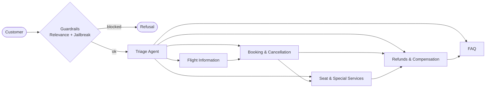

# Customer Service Agents on Amazon Bedrock

A demo of an airline customer service desk built from **six cooperating AI agents** with the
[OpenAI Agents SDK](https://openai.github.io/openai-agents-python/). In this version the agents run on
**Anthropic Claude models through Amazon Bedrock** instead of OpenAI. Every step is traced in
**Langfuse** and scored against a signed set of acceptance criteria by **EvalTrust**.

The agent code comes from OpenAI's public demo,
[openai/openai-cs-agents-demo](https://github.com/openai/openai-cs-agents-demo) (MIT licence, commit
`bd7bfca`, Dec 2025). Only two lines of that code were changed. Everything EvalTrust added lives in new
files next to it.

> **This is a demo, not a production system.** Flights, bookings, vouchers and refunds are mock data. The
> upstream README says the app *"is designed for demonstration purposes"*. See
> [Known issues](docs/10-known-issues.md) for what would have to change before real customers use it.

## What it does

A customer chats with one assistant. Behind it, a **Triage Agent** reads each message and hands the
conversation to the right specialist:

| Agent | Handles | Tools |
| --- | --- | --- |
| Triage Agent | Routes every request; loads the trip if needed | `get_trip_details` |
| Flight Information Agent | Flight status, missed connections, alternatives | `flight_status_tool`, `get_matching_flights` |
| Booking and Cancellation Agent | New bookings, rebooking, cancellations | `cancel_flight`, `get_matching_flights`, `book_new_flight` |
| Seat and Special Services Agent | Seat changes, front-row and medical seating | `update_seat`, `assign_special_service_seat`, `display_seat_map` |
| FAQ Agent | Baggage, seats, Wi-Fi and compensation policy | `faq_lookup_tool` |
| Refunds and Compensation Agent | Compensation cases, hotel and meal vouchers | `issue_compensation`, `faq_lookup_tool` |

Two **guardrails**, *Relevance* (off-topic) and *Jailbreak* (prompt attacks), check every customer
message before any agent acts on it.



## Documentation

| # | Document | What it covers |
| --- | --- | --- |
| 1 | [Architecture and orchestration](docs/01-architecture.md) | Components, request lifecycle, handoffs, the run loop |
| 2 | [Agents](docs/02-agents.md) | Each agent's role, instructions, tools and handoffs |
| 3 | [Tools](docs/03-tools.md) | Every tool: inputs, what it reads and writes, mock behaviour |
| 4 | [Guardrails](docs/04-guardrails.md) | Relevance and jailbreak checks, how a block works |
| 5 | [Context and sessions](docs/05-context-and-sessions.md) | What is remembered, where, and for how long |
| 6 | [OpenAI → Bedrock migration](docs/06-bedrock-migration.md) | How the models were swapped, and why it needs no API key |
| 7 | [AWS deployment](docs/07-aws-deployment.md) | EC2, IAM, Caddy, systemd, URLs, cost and shutdown |
| 8 | [Observability with Langfuse](docs/08-observability-langfuse.md) | Tracing setup and how to read a trace |
| 9 | [Evaluation](docs/09-evaluation.md) | Signed criteria, golden dataset, scorers, τ²-bench, results |
| 10 | [Known issues](docs/10-known-issues.md) | Findings F1–F6 traced to the exact code that causes them |
| 11 | [Criteria and scores playbook](docs/11-criteria-and-scores-playbook.md) | How criteria, scorers and golden cases fit; adding a criterion; reading results in Langfuse |
| 12 | [EvalTrust Runner](docs/12-runner.md) | What the runner shows, how to read a report, how it connects to Langfuse |

The original upstream README is kept at [docs/upstream-README.md](docs/upstream-README.md).

## Repository layout

```
python-backend/
  airline/agents.py         six agents, their instructions and handoffs      (upstream, 1 line changed)
  airline/guardrails.py     relevance and jailbreak guardrails               (upstream, 1 line changed)
  airline/tools.py          the function tools (mock airline back office)    (upstream)
  airline/context.py        the booking context shared by all agents         (upstream)
  airline/demo_data.py      two mock itineraries                             (upstream)
  server.py, main.py        original ChatKit server and FastAPI app          (upstream)
  eval_api.py               EvalTrust: chat page + /chat/api + /eval/conversation   (new)
  tracing_langfuse.py       EvalTrust: send Agents SDK traces to Langfuse            (new)
  requirements-evaltrust.txt  pinned versions used on the lab server                 (new)
evaluation/                 EvalTrust runner (CLI + web page): criteria, golden sets, scorers, exporters (new)
deploy/                     systemd unit, env template, Caddyfile                      (new)
ui/                         original Next.js + ChatKit UI (not used in this deployment)
docs/                       this documentation
```

## Quick start (local)

You need Python 3.11+, AWS credentials that can call Bedrock in `us-east-2`, and model access to Claude
Sonnet 4.6 and Claude Haiku 4.5.

```bash
cd python-backend
python -m venv .venv && source .venv/bin/activate
pip install -r requirements.txt -r requirements-evaltrust.txt

export AGENT_MODEL=litellm/bedrock/global.anthropic.claude-sonnet-4-6
export GUARDRAIL_MODEL=litellm/bedrock/us.anthropic.claude-haiku-4-5-20251001-v1:0
export AWS_REGION_NAME=us-east-2 AWS_DEFAULT_REGION=us-east-2
export OPENAI_API_KEY=not-used-bedrock-only
# optional tracing:
# export LANGFUSE_HOST=http://localhost:3000 LANGFUSE_PUBLIC_KEY=pk-lf-... LANGFUSE_SECRET_KEY=sk-lf-...

uvicorn eval_api:app --port 8100
```

Open http://localhost:8100 and try *"My flight from Paris to New York was delayed and I'll miss my
connection to Austin."* The tags under each reply show the agent, handoffs, tools and guardrail.

## Results at a glance

Evaluated on 2026-11-07 with Claude Sonnet 4.6 (agents) and Claude Haiku 4.5 (guardrails).

| Measure | Result |
| --- | --- |
| Signed criteria passed (50-case golden set) | 5 of 9, verdict **HOLD** |
| Routing to the right agent | 96.4% |
| Correct tool arguments | 85.7% (target 95%) |
| No unrequested cancel / rebook / payout | 92.9% (target 100%) |
| τ²-bench airline, pass^1 | 0.76 (38 of 50 tasks) |
| τ²-bench write actions correct | 57.1% |

Details: [Evaluation](docs/09-evaluation.md) and [Known issues](docs/10-known-issues.md).

## Licence and credit

The agent application is © OpenAI, MIT licence ([LICENSE](LICENSE)). The EvalTrust additions (Bedrock
configuration, tracing, evaluation harness and documentation) are by Mohcine Madkour,
[EvalTrust](https://evaltrust.cloud).
