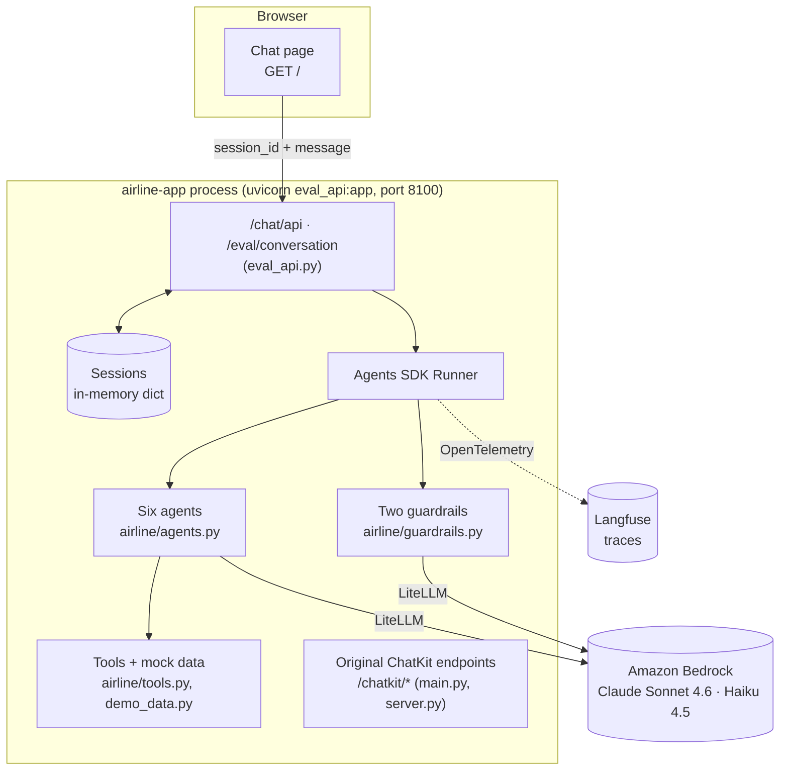

# 1. Architecture and orchestration

The app is one Python process. Each customer message goes to the agent that answered last; that agent
can call tools and hand the conversation to another agent. A conversation never leaves the process.

## Components

| Component | File | Role |
| --- | --- | --- |
| FastAPI app | `main.py` | The upstream app: `/chatkit` endpoints for the Next.js UI, `/health` |
| EvalTrust API | `eval_api.py` | Imports the upstream app unchanged and adds a chat page (`/`), `/chat/api` and `/eval/conversation` |
| Runner | OpenAI Agents SDK | Runs the agent loop: model call → tool calls → handoff → repeat |
| Agents | `airline/agents.py` | Six agents with instructions, tools and allowed handoffs |
| Guardrails | `airline/guardrails.py` | Two small classifier agents that can stop a turn |
| Tools | `airline/tools.py` | Python functions the models can call; they read and write the booking context |
| Mock data | `airline/demo_data.py` | Two itineraries: *disrupted* (Paris → New York → Austin) and *on time* (SFO → LAX) |
| Tracing | `tracing_langfuse.py` | Sends every agent, model, tool and guardrail span to Langfuse |

The upstream Next.js UI in `ui/` and the `/chatkit` endpoints still exist but are not used in the AWS
deployment. They depend on OpenAI's ChatKit front end, and this deployment uses no OpenAI service.
`eval_api.py` drives the same agents through the same Runner instead.

## Lifecycle of one customer message

What `run_turn()` in `eval_api.py` does. It mirrors the upstream `AirlineServer.respond()` in
`server.py`, without streaming.

1. **Find the session.** `/chat/api` receives `{session_id, message}`. A new session gets the id
   `chat-<10 hex>` and starts with an empty context and the Triage Agent as current agent.
2. **Append the message** to the session's conversation history (`input_items`).
3. **Run the current agent:** `Runner.run(current_agent, input_items, context=..., max_turns=12)`.
   The whole history goes to the model.
4. **Guardrails run** on the latest user message, using Claude Haiku 4.5. If either trips, the SDK
   raises `InputGuardrailTripwireTriggered`; the turn ends with a fixed refusal and no tool runs.
5. **The agent loop.** The model, Claude Sonnet 4.6, either:
   - calls one or more **tools**: the SDK runs the Python function and feeds the result back;
   - emits a **handoff**: the SDK switches the active agent, runs the handoff's `on_handoff` hook (which
     may fill the context) and continues with the new agent and the same history; or
   - writes a **final reply**, which ends the run.

   Each model call, tool call and handoff counts as a step. More than 12 raises `MaxTurnsExceeded`.
6. **Save state.** The history becomes `result.to_input_list()`, which includes tool calls and results.
   The current agent becomes `result.last_agent`, so the next message starts with the specialist, not
   Triage.
7. **Return a record** with the reply, agents visited, handoffs, tool calls with arguments, any
   guardrail result, the public context and latency. The chat page shows it as tags; the evaluator scores
   it.
8. **Flush traces** to Langfuse.

## Handoff graph

Handoffs are tools the model can call (`transfer_to_<agent>`). An agent can only hand off to the agents
listed for it in `agents.py`:

| From | Can hand off to |
| --- | --- |
| Triage | Flight Information, Booking & Cancellation\*, Seat & Special Services\*, FAQ, Refunds & Compensation |
| Flight Information | Booking & Cancellation\*, Triage |
| Booking & Cancellation | Seat & Special Services\*, Refunds & Compensation, Triage |
| Seat & Special Services | Refunds & Compensation, Triage |
| Refunds & Compensation | FAQ, Triage |
| FAQ | Triage |

\* These handoffs run an `on_handoff` hook first. It calls `apply_itinerary_defaults()` and, if the
confirmation or flight number is still empty, **makes up a random one** (for example `FLT-482`, `Q7ZK2M`).
See [Known issues](10-known-issues.md).

## Orchestration style

- **Decentralised routing.** There is no central planner. Triage picks a specialist, and each specialist
  decides on its own when to hand off again.
- **Autonomous multi-step work.** Every specialist prompt says to chain tool calls *"without waiting for
  user responses when data is available"*. This makes it fast, and it is also the root of finding F1
  (acting without consent).
- **One handoff per message.** Each prompt limits the agent to one handoff per turn, to stop agents
  bouncing the customer between them.
- **Shared context.** All agents read and write one `AirlineAgentContext` object (see
  [Context and sessions](05-context-and-sessions.md)). Agent instructions are functions that read it
  each turn, so a prompt always shows the current confirmation, flight and seat.
- **Standard handoff prompt.** Every agent's instructions start with the SDK's
  `RECOMMENDED_PROMPT_PREFIX`, which explains handoffs to the model.

## Endpoints

| Method | Path | Added by | Purpose |
| --- | --- | --- | --- |
| GET | `/` | EvalTrust | Simple chat page with agent, handoff, tool and guardrail tags |
| POST | `/chat/api` | EvalTrust | One chat turn: `{session_id?, message}` → turn record |
| POST | `/eval/conversation` | EvalTrust | Replay 1–12 turns in a fresh session: `{case_id, turns[]}` → all turn records + final context |
| POST | `/chatkit` | upstream | ChatKit protocol for the Next.js UI |
| GET | `/chatkit/state`, `/chatkit/bootstrap`, `/chatkit/state/stream` | upstream | UI state and live updates |
| GET | `/health` | upstream | Health check |
