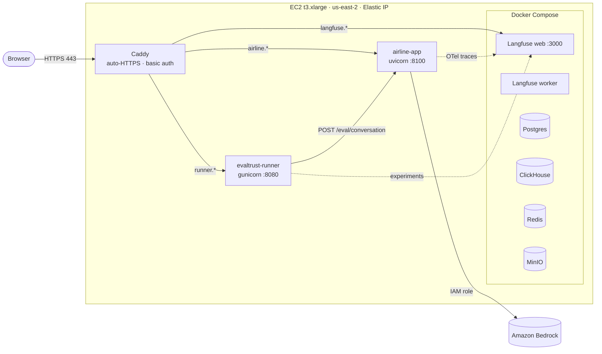

# 7. AWS deployment

The whole lab runs on **one EC2 instance in the client's own AWS account**: the airline app, the EvalTrust
runner and a self-hosted Langfuse. Model calls go to Bedrock in the same account, so no conversation data
leaves it.

## Layout



## Resources

| Resource | Value |
| --- | --- |
| Instance | EC2 `t3.xlarge` (4 vCPU, 16 GiB), Ubuntu 24.04 LTS, Python 3.12, `us-east-2b`, tag `project=evaltrust-lab` |
| Disk | 40 GiB gp3 |
| Public address | Elastic IP `3.143.190.229` |
| Security group | inbound TCP 80 and 443 only. No SSH; admin goes through SSM Session Manager |
| IAM role `evaltrust-lab-ec2` | `AmazonSSMManagedInstanceCore` + Bedrock invoke/converse (see [migration](06-bedrock-migration.md)) + `s3:GetObject` on the lab bucket |
| S3 bucket | `evaltrust-lab-<account-id>-use2`, used to move files onto the server |
| Bedrock models | Claude Sonnet 4.6 (global profile), Claude Haiku 4.5 (US profile) |

## URLs

| Service | URL | Login |
| --- | --- | --- |
| Airline app | https://airline.3.143.190.229.sslip.io | Caddy basic auth |
| EvalTrust runner | https://runner.3.143.190.229.sslip.io | Caddy basic auth |
| Langfuse | https://langfuse.3.143.190.229.sslip.io | Langfuse account; project *EvalTrust Lab* |

[sslip.io](https://sslip.io) is a free DNS service: any name ending in `<ip>.sslip.io` resolves to that
IP. That lets Caddy get real Let's Encrypt certificates without a domain. For a client, replace it with a
proper domain such as `airline.lab.evaltrust.cloud`.

## Services on the instance

| Service | How it runs | Port | Config |
| --- | --- | --- | --- |
| `airline-app` | systemd, `uvicorn eval_api:app` | 127.0.0.1:8100 | [`deploy/airline-app.service`](../deploy/airline-app.service), `/etc/airline-app.env` ([template](../deploy/airline-app.env.example)) |
| `evaltrust-runner` | systemd, `gunicorn -w 1 --threads 4 -t 300 webapp:app` | 127.0.0.1:8080 | `/etc/evaltrust-runner.env` |
| Langfuse v4 (web, worker, AI gateway, Postgres, ClickHouse, Redis, MinIO) | Docker Compose in `/opt/langfuse`, image `langfuse/langfuse:4` | 3000 (web) | Langfuse self-hosting compose file |
| Caddy | Docker container `caddy` (image `caddy:2`) | 80, 443 | [`deploy/Caddyfile`](../deploy/Caddyfile) |
| τ²-bench | installed in `/opt/tau2-bench`, run on demand | n/a | n/a |

The app and the runner listen on localhost only. Docker publishes some Langfuse ports on all
interfaces, but the security group blocks everything except 80 and 443.

## Install steps (from scratch)

```bash
# 1. App code
sudo git clone https://github.com/mohcinemadkour/customer-service-agents-sdk-bedrock /opt/airline-app
cd /opt/airline-app/python-backend
python3 -m venv .venv
.venv/bin/pip install -r requirements.txt -r requirements-evaltrust.txt

# 2. Configuration
sudo cp ../deploy/airline-app.env.example /etc/airline-app.env
sudo chmod 600 /etc/airline-app.env      # then fill in the Langfuse keys

# 3. Service
sudo cp ../deploy/airline-app.service /etc/systemd/system/
sudo systemctl daemon-reload && sudo systemctl enable --now airline-app
curl -s localhost:8100/health            # {"status":"healthy"}

# 4. HTTPS: put deploy/Caddyfile (with your IP and a `caddy hash-password` hash) in front
```

Langfuse: follow the [self-hosting guide](https://langfuse.com/self-hosting/docker-compose), create a
project, and copy its public and secret keys into `/etc/airline-app.env`.

## Day-to-day operations

```bash
sudo systemctl status airline-app             # is it running?
sudo journalctl -u airline-app -f             # live logs; look for "[tracing] ... enabled: True"
sudo systemctl restart airline-app            # after changing /etc/airline-app.env (clears all sessions)
docker ps                                     # Langfuse containers
```

Without SSH, connect with AWS Systems Manager:
`aws ssm start-session --target <instance-id> --region us-east-2`.

## Cost and shutdown

Approximate on-demand prices, not quoted from AWS:

| Item | Approx. cost |
| --- | --- |
| t3.xlarge running | about $0.17 per hour (about $120 per month if left on) |
| 40 GiB gp3 | about $3 per month |
| Elastic IP | about $0.005 per hour |
| Bedrock | per token, billed separately; check Cost Explorer after a run |

Stop the instance when you are not testing. Disk and Elastic IP keep their small charges; Langfuse data
and the code stay on the disk. After a start, the services come back by themselves: the systemd units are enabled, and the
containers use `restart: always` (Caddy: `unless-stopped`).
