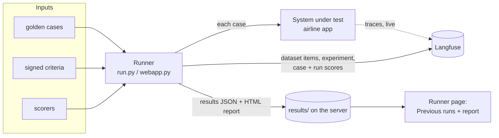

# 12. EvalTrust Runner

The runner is the tool that **produces the verdict**. It sends every golden case to the system, scores
each answer with the scorers, compares the averages with the signed criteria, and returns **PASS** or
**HOLD** with a report. It has two faces: a command line (`evaluation/run.py`) and a small web page
(`evaluation/webapp.py`) that runs the same code.

Lab URL: https://runner.3.143.190.229.sslip.io (Caddy basic auth).

## How the runner and Langfuse fit together



| | Runner | Langfuse |
| --- | --- | --- |
| Job | Runs the test, decides the verdict | Stores the evidence and lets you dig into it |
| Knows the criteria and targets | **Yes**: it reads the criteria file | Only through the run scores' comments |
| Has the scorer logic | **Yes** | No, only the scores produced |
| Main output | PASS or HOLD, report, exit code | Traces, datasets, experiments, scores |
| Best for | "Can we release?" and a report for the client | "Why did case AL-049 fail?" |

They connect in two ways:
1. **Traces, written live.** The airline app sends a trace for every turn as the runner drives it.
   Golden-run sessions are named `eval-<case_id>-<id>`.
2. **Experiment, written at the end.** `langfuse_export.py` creates or updates the dataset
   `golden-<dataset file name>`, records the run as an experiment named after the run label, attaches
   every case score, and adds the run scores `criterion.*` and `evaltrust.gate`.

If Langfuse keys aren't set, the runner still works; the run page then says "Langfuse: not sent".

## What a run does

1. Load the criteria file and the golden cases.
2. Send each case to the system, `--concurrency` cases at a time (use 1 for Bedrock to avoid
   throttling).
3. Score each answer with every scorer in the module's `ALL` list. This uses the Braintrust open-source
   SDK, locally (`no_send_logs=True`), so nothing is sent to Braintrust.
4. For each criterion, average its scorer over the cases where it applies. For latency, take the 95th
   percentile of each case's slowest turn. Compare with the target and direction.
5. Verdict: **PASS** only if every criterion passes and no case errored; otherwise **HOLD**.
6. Write `results/<label>.json` (every case's input, output and scores) and `results/<label>_report.html`.
7. Export to Langfuse.
8. Exit with code 0 on PASS or 1 on HOLD. That is what lets it block a release in CI.

## The web page

### Run an evaluation

| Field | Meaning |
| --- | --- |
| System to test | A built-in sample (prior-authorization system v2.3, v2.4 or v2.4b), or **A real endpoint (URL)** |
| Run name | The label. It becomes the file name, the report title and the Langfuse experiment name |
| Endpoint URL | For a real system: the client's API URL |
| Header | Optional, one `Key=Value`, e.g. `Authorization=Bearer …` |
| Field map | Optional: maps our field names to the client's, e.g. `decision=result.outcome` |
| Compare with | Optional: an earlier run. The report then shows old against new per criterion |

**Current limit:** the form always uses the built-in prior-authorization sample: 12 cases in
`golden/priorauth_v1.2.csv` with the criteria in `criteria.json`. Airline runs are started from the
command line (below). They still appear in **Previous runs** and open like any other run.

### Built-in samples (demo story)

| Version | Behaviour | Expected verdict |
| --- | --- | --- |
| v2.3 "live" | Retriever returns superseded policies | HOLD |
| v2.4 candidate | Retriever fixed, but the new writer model over-shares patient data and escalates less | HOLD |
| v2.4b candidate | Retriever fixed, original writer model | PASS |

The demo shows that a version which looks better (v2.4) can still fail the gate.

### Previous runs

Every results file on the server, newest first: run name, system, number of cases, verdict, time.
Click one to open it.

### A run's page

- **Top line:** whether the run was sent to Langfuse (with the dataset and run name and a link), plus
  links for a new run and the report on its own page.
- **The report** (embedded):
  - **Header:** project, client, system, dataset and number of cases, time.
  - **Verdict banner:** "HOLD: N criteria failed" in red, or "PASS: all criteria met" in green.
  - **Results against signed criteria:** each criterion with its owner and `n` (how many cases it
    applied to), target, result (and the baseline if compared), and Pass or Fail.
  - **Failed cases:** every case with at least one 0, showing the request, a summary of what was
    expected, what the system answered, and which checks failed.
  - **Method:** one paragraph on how it was scored.

### How to read a report

1. Start with the **verdict**.
2. In the criteria table, look at the **failed rows and their owners**: that tells you who has to act.
3. Check **n**. A criterion that applies to few cases moves a lot with one failure.
4. In **Failed cases**, group by the failed check. The same check failing across several cases usually
   means one root cause (see [Known issues](10-known-issues.md)).
5. For any case you want to understand, open Langfuse: Datasets → the dataset → Experiments → the run →
   the case's **↗**, to see the full trace.

## Command line

```bash
cd evaluation
pip install -r requirements.txt
export LANGFUSE_HOST=... LANGFUSE_PUBLIC_KEY=... LANGFUSE_SECRET_KEY=...   # optional

# airline app, golden v1 (result of record: run 3)
python run.py --system airline:http://127.0.0.1:8100 \
  --dataset golden/airline_v1.jsonl --criteria criteria_airline.json \
  --scorers scorers_airline --label airline-sonnet-4.6-run3 --concurrency 1

# compare a new run against an earlier one
python run.py ... --label airline-fix-1 --baseline results/airline-sonnet-4.6-run3.json

# a client's own endpoint
python run.py --system https://staging.client.com/agent --header "Authorization=Bearer XXX" \
  --field-map decision=result.outcome --dataset golden/<their_set>.csv --criteria <their_criteria>.json
```

| Option | Meaning |
| --- | --- |
| `--system` | `airline:<url>`, `mock:2.3` / `mock:2.4` / `mock:2.4b`, or an `https://` endpoint |
| `--dataset` | Golden cases, CSV or JSONL |
| `--criteria` | Signed criteria file |
| `--scorers` | Python module with the scorers' `ALL` list (`scorers` or `scorers_airline`) |
| `--label` | Run name |
| `--baseline` | Results JSON of an earlier run to compare against |
| `--header`, `--field-map` | For HTTP endpoints |
| `--concurrency` | Cases in parallel (default 4; use 1 on Bedrock) |
| `--out` | Results folder (default `results/`) |

On the lab server, long runs are started as a background service so they survive a lost connection:

```bash
sudo systemd-run --unit evaltrust-<name> --property=EnvironmentFile=/etc/evaltrust-runner.env \
  --working-directory=/opt/evaltrust-runner /opt/evaltrust-runner/.venv/bin/python run.py ...
journalctl -u evaltrust-<name> -f        # follow progress
```

## Running the web page

```bash
cd evaluation
LANGFUSE_HOST=... LANGFUSE_PUBLIC_KEY=... LANGFUSE_SECRET_KEY=... \
LANGFUSE_PUBLIC_URL=https://langfuse.example.com \
gunicorn -w 1 --threads 4 -t 300 -b 127.0.0.1:8080 webapp:app
```

`LANGFUSE_PUBLIC_URL` is the address used for the "Open Langfuse" links. Login is handled by the reverse
proxy (Caddy basic auth); the app itself has none. Only one run executes at a time.
